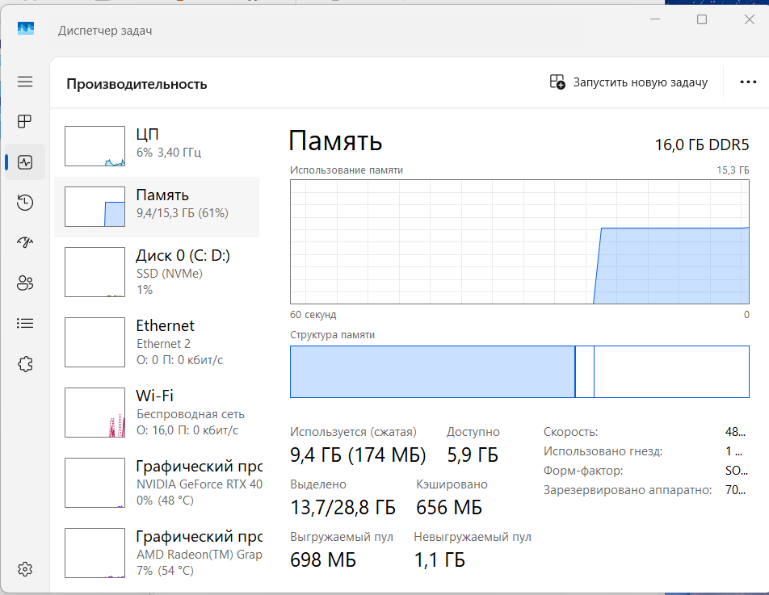
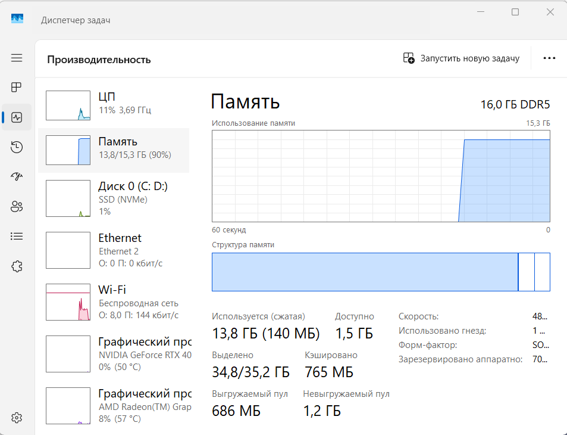

# Lab 02: Windows Guest, Network Both Ways, Overcommitment

## Student Information
- **Name:** Kuspek Nuraly
  - **Date:** 2026-10-31

---

## 1. Network Mode & Architectural Rationale

### Selected Mode: NAT Network (`NatNetwork`)
Oracle VirtualBox was configured using the shared **NAT Network** mode instead of standard per-VM NAT, Bridged, or Host-Only adapters:

- **Why standard NAT was not chosen:** Under default NAT, each VM sits behind its own independent, isolated NAT gateway engine. Both VMs would typically be assigned the duplicate address `10.0.2.15` in isolated subnets, rendering direct guest-to-guest IP communication impossible without configuring host port-forwarding rules.
  - **Why Bridged Adapter was avoided:** Bridged networking attaches each virtual network interface directly to the physical host network. On strict campus, enterprise, or Wi-Fi networks, MAC filtering, 802.1X authentication, or router DHCP leasing limits often prevent secondary virtual interfaces from obtaining IP addresses.
  - **Why NAT Network fits all requirements:** A shared NAT Network creates an internal virtual software bridge with an integrated VirtualBox DHCP service (`10.0.2.0/24`). Both guest machines receive unique dynamic IP leases in the same subnet (`10.0.2.3` and `10.0.2.15`), permitting bidirectional peer-to-peer traffic while forwarding outbound traffic via the host's network adapter to the internet.

---

## 2. Network Diagram

```text
+-------------------------------------------------------------+
|                        Host Machine                         |
|                   Windows 11 (16.0 GB RAM)                  |
+-------------------------------------------------------------+
                               |
                     [ VirtualBox Hypervisor ]
                               |
+-------------------------------------------------------------+
|             VirtualBox NAT Network (NatNetwork)             |
|          Subnet: 10.0.2.0/24 | DHCP: Enabled                |
|               Gateway / DNS: 10.0.2.1                       |
+-------------------------------------------------------------+
               |                               |
       [ IP: 10.0.2.3/24 ]             [ IP: 10.0.2.15/24 ]
       [ Interface: enp0s3 ]           [ Adapter: Ethernet ]
               |                               |
+------------------------------+ +----------------------------+
|      Guest 1: Ubuntu Linux   | |    Guest 2: Windows 11 VM  |
|      Ubuntu 26.04.1 LTS      | |    Windows 11 Evaluation   |
|   Base: 2 vCPU | 2 GB RAM    | |    Base: 2 vCPU | 4 GB RAM |
|   Overcommit: 10 GB RAM      |<|>   Overcommit: 10 GB RAM   |
+------------------------------+ +----------------------------+
               \                               /
                \                             /
                 -----> [ Internet Gateway ] <
                         ping ubuntu.com (OK)
```

---

## 3. Windows Firewall Rule (ICMPv4)

### Problem
The first ping test from Windows to Ubuntu succeeded. However, the ping from Ubuntu (`10.0.2.3`) to Windows (`10.0.2.15`) initially failed: all 4 packets were lost. This indicated that Windows was not responding to inbound ICMP echo requests, consistent with the default Windows Defender Firewall rule blocking inbound ICMP traffic.

### Rule Required
To allow Ubuntu to ping the Windows guest, an inbound rule for ICMPv4 Echo Request was created. Run PowerShell **as Administrator** inside the Windows guest:

```powershell
New-NetFirewallRule -DisplayName "Allow ICMPv4 Echo Request" -Protocol ICMPv4 -IcmpType 8 -Direction Inbound -Action Allow
```

Once applied, Ubuntu successfully received ICMP Echo Replies from the Windows guest with 0% packet loss.

---

## 4. Host Memory Analysis & Overcommitment

### Overcommitment Setup
The physical host laptop features **16.0 GB of physical RAM** (15.3 GB usable). Under normal operating conditions, base memory assignments were 2 GB for Ubuntu and 4 GB for Windows 11 (6 GB total, well within host physical limits).

To test host hypervisor memory management and analyze degradation under **memory overcommitment**, memory allocations were intentionally raised on both guests simultaneously so that their combined configured RAM exceeded physical host capacity:
- **Guest 1 (Ubuntu Linux):** raised to **10240 MB (10 GB)**
  - **Guest 2 (Windows 11 VM):** raised to **10240 MB (10 GB)**
  - **Total Provisioned Guest Memory:** **20480 MB (20 GB)**

This configuration represents a **130% overcommit** relative to usable host memory (20.0 GB provisioned vs. 15.3 GB usable). VirtualBox commits guest memory pages dynamically as they are touched by guest operating systems. As both guests booted and initialized active background services, physical RAM contention increased dramatically on the host.

### Memory Allocation: Before vs. Overcommit Workload

| Measurement / Parameter | Baseline (Before Workload) | Under Overcommit (10 GB + 10 GB) |
| :--- | :--- | :--- |
| **Guest 1 (Ubuntu) Configured RAM** | 2048 MB (2 GB) | **10240 MB (10 GB)** |
| **Guest 2 (Windows) Configured RAM** | 4096 MB (4 GB) | **10240 MB (10 GB)** |
| **Total Virtual RAM Provisioned** | 6144 MB (6 GB / 39% host) | **20480 MB (20 GB / 130% host)** |
| **Host Installed Physical RAM** | 16.0 GB DDR5 | 16.0 GB DDR5 |
| **Host Usable Memory (Task Manager)** | 15.3 GB | 15.3 GB |
| **Host Memory in Use** | **9.4 GB** | **13.8 GB** |
| **Host Memory Usage (%)** | **61%** | **90%** |
| **Host Available Memory** | **5.9 GB** | **1.5 GB** |

**Change:** Under the 20 GB overcommitted workload, host memory in use increased by **+4.4 GB**, and host utilization climbed from **61% to 90%** (+29 percentage points). Available host memory dropped from **5.9 GB to a critical 1.5 GB**, forcing Windows 11 memory manager to trim application working sets and initiate pagefile compression/swapping.

### Evidence Screenshots

**Before Workload (Baseline):**



**Under Overcommit Workload:**



These screenshots record host RAM usage at two critical points in time. They demonstrate heavy host memory pressure under the 20 GB combined overcommit workload, driving usable host memory into the 90% utilization threshold with only 1.5 GB remaining available for all host background tasks.

---

## 5. What Did Not Work

1. **Ubuntu to Windows ping before the firewall change:** The command `ping -c 4 10.0.2.15` transmitted 4 packets and received none (100% packet loss). After the inbound ICMPv4 firewall rule was added inside Windows, all 4 packets received replies (0% packet loss).
   2. **Internet ping from Windows was not completely successful:** The Windows test to `ubuntu.com` received 3 of 4 replies (25% packet loss). The reported reply times were 2265–3286 ms, which were unusually high in this test.
   3. **Internet ping from Ubuntu was slow:** Ubuntu received all 4 replies from `ubuntu.com` (0% packet loss), but the reported round-trip times were 6787–8878 ms. Connectivity worked, but response times were very high.
   4. **Host memory starvation under 20 GB overcommit:** When both guests were provisioned with 10 GB RAM each (total 20 GB on a 16 GB host), the host memory in use surged to 13.8 GB (90%), leaving only 1.5 GB available. Host applications experienced noticeable micro-stuttering due to working set trimming and active page swapping to disk.
   5. **Initial misconception on overcommit limits:** Initially testing with 2 GB + 4 GB (6 GB total) did not exceed the 16 GB host boundary. The experiment had to be re-run with 10 GB assigned to each VM (20 GB total) to achieve true memory overcommitment and trigger hypervisor memory pressure.

### Overall Result
The two guest machines were assigned different IP addresses in the same NAT Network subnet (`10.0.2.3` and `10.0.2.15`). Bidirectional guest-to-guest ping worked after allowing inbound ICMPv4 Echo Request traffic in the Windows firewall. Internet connectivity was demonstrated from both guests. Memory overcommitment was validated by assigning 20 GB virtual RAM (10 GB + 10 GB) across both guests on a 16 GB physical host, resulting in 90% host memory saturation (13.8 GB in use, 1.5 GB available).

---

## 6. Evidence Files

* `evidence/ping.txt` — ICMP ping logs showing blocked Ubuntu → Windows traffic, firewall rule activation, bidirectional pings, and external internet reachability.
  * `evidence/host-memory-before.png` — Host Task Manager showing baseline memory usage (9.4 GB in use, 5.9 GB available).
  * `evidence/host-memory-after.png` — Host Task Manager showing memory pressure under overcommitment (13.8 GB in use, 1.5 GB available).
  * `evidence/ip-addr-linux.txt` — Guest interface addressing and subnet configuration (`10.0.2.3/24`).
  * `evidence/vm-settings.png` — VM network and hardware allocation details.
