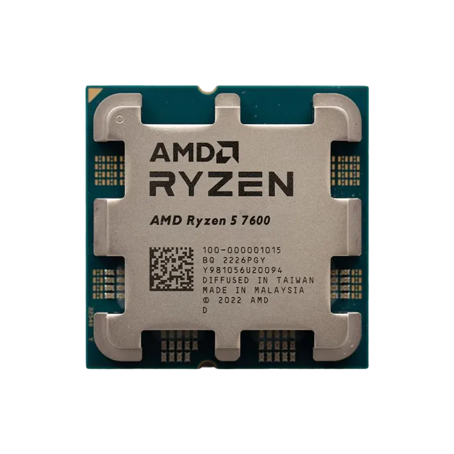
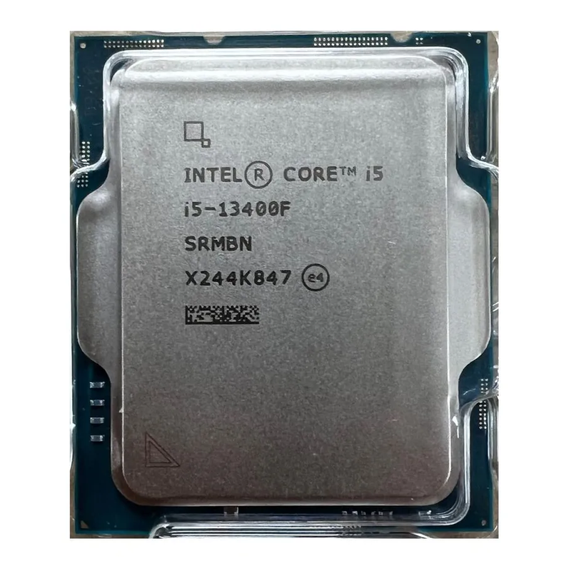
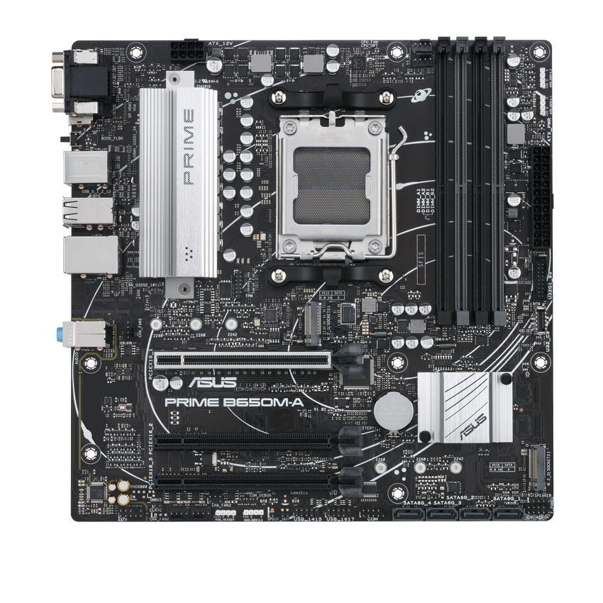
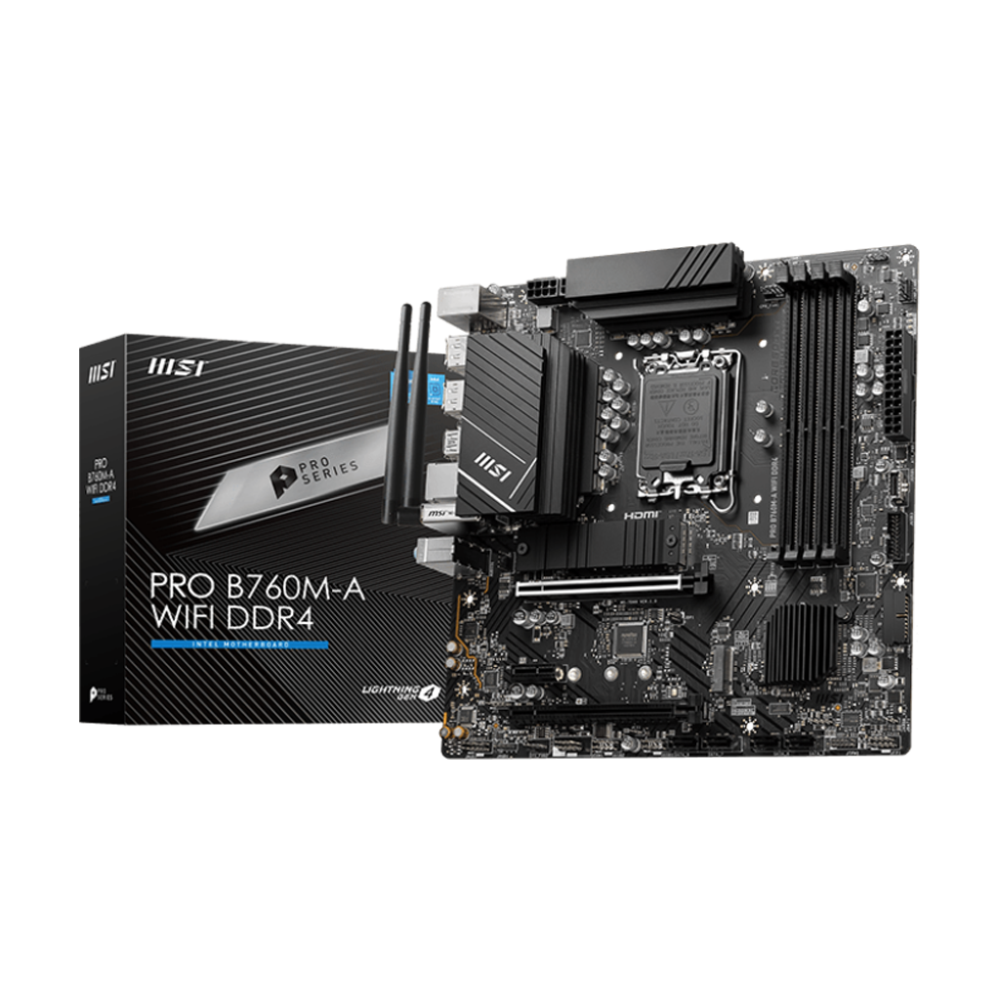
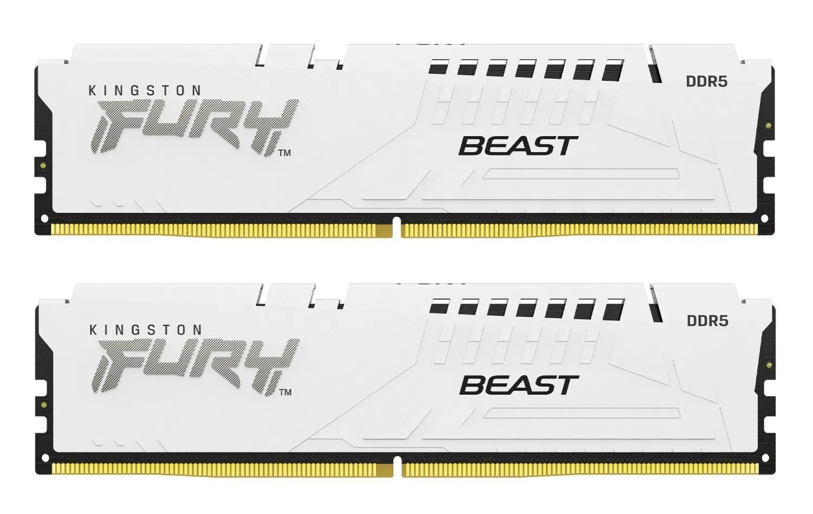
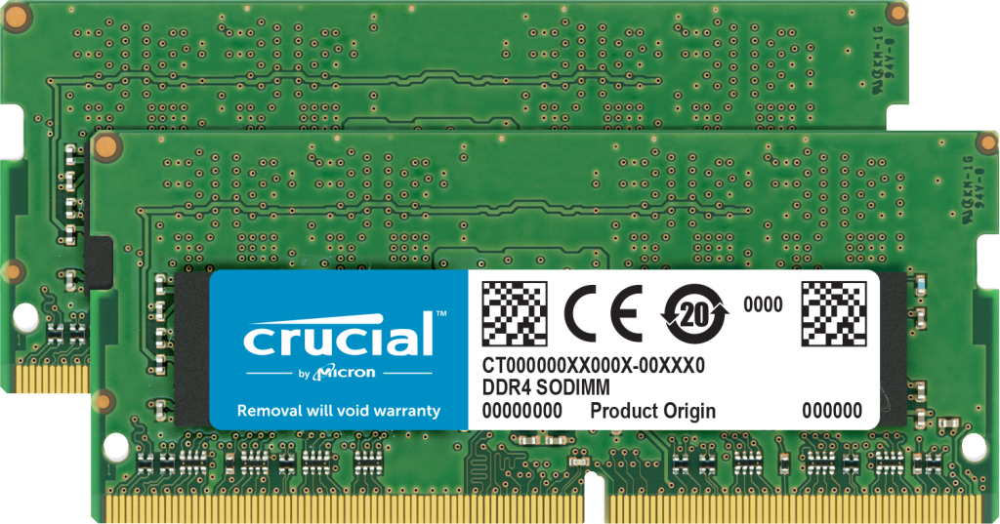
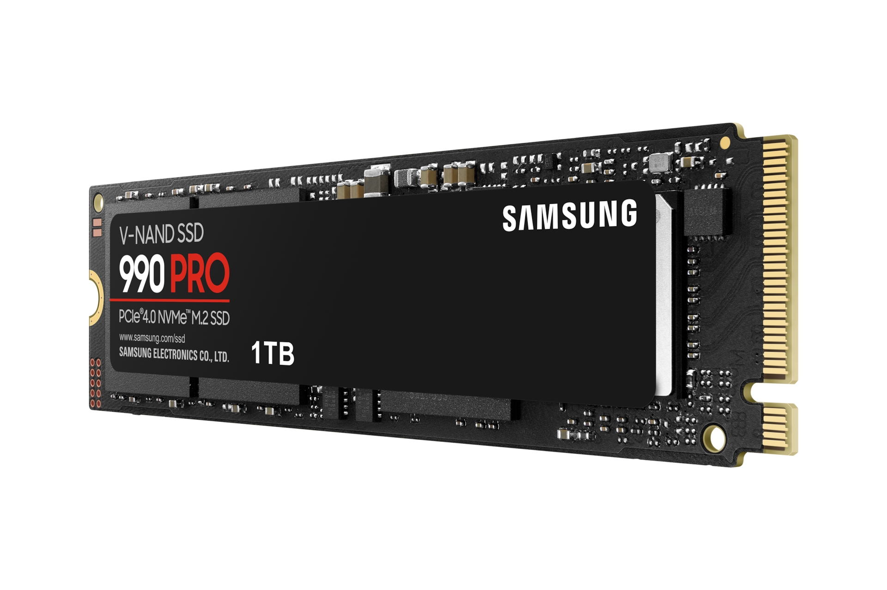
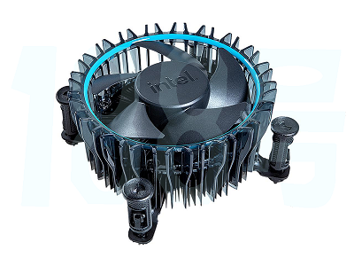

# Lab 3 — Teardown, and the Same Machine from the Command Line

**Course:** IFT 103 — Operating System Architecture  
**Student:** Nuraly Kuspek  
**Work type:** Individual work  
**Date:** 9 November 2026

## Part 1 — Ten Parts

This section identifies ten computer components, their technical specifications, connections, compatibility requirements, and limitations.

### 1. AMD Ryzen 5 7600 — Processor

**Specifications:** 6 cores, 12 threads, 3.8 GHz base frequency, up to 5.1 GHz boost, 32 MB L3 cache, 65 W TDP.

**What it is:** A desktop CPU that processes instructions and performs calculations.

**What it connects to:** An AM5 motherboard with DDR5 memory.

**Limitations:** Cannot work with Intel LGA1700 motherboards or DDR4 memory.

**Manufacturer:** https://www.amd.com/en/products/processors/desktops/ryzen/7000-series/amd-ryzen-5-7600.html

### 2. Intel Core i5-13400 — Processor

**Specifications:** 10 cores, 16 threads, up to 4.6 GHz, 20 MB Smart Cache, 65 W base power.

**What it is:** A desktop processor with performance and efficiency cores.

**What it connects to:** An LGA1700 motherboard with compatible DDR4 or DDR5 memory.

**Limitations:** Cannot be installed in an AMD AM5 socket.

**Manufacturer:** https://www.intel.com/content/www/us/en/products/sku/230495/intel-core-i513400-processor-20m-cache-up-to-4-60-ghz/specifications.html

### 3. ASUS PRIME B650M-A — Motherboard

**Specifications:** AMD B650 chipset, AM5 socket, Micro-ATX, four DDR5 slots, two M.2 slots, four SATA ports.

**What it is:** A motherboard connecting the CPU, RAM, storage, and peripherals.

**What it connects to:** AMD Ryzen processors, DDR5 memory, NVMe SSDs, SATA devices, and ATX power supplies.

**Limitations:** Does not support Intel processors or DDR4 RAM.

**Manufacturer:** https://www.asus.com/motherboards-components/motherboards/prime/prime-b650m-a/

### 4. MSI PRO B760M-A WIFI DDR4 — Motherboard

**Specifications:** Intel B760 chipset, LGA1700 socket, Micro-ATX, four DDR4 slots, two M.2 slots, four SATA ports.

**What it is:** A motherboard designed for compatible Intel processors.

**What it connects to:** Intel Core i5-13400, DDR4 memory, SATA and NVMe storage, and an ATX power supply.

**Limitations:** Does not support AMD processors or DDR5 memory.

**Manufacturer:** https://www.msi.com/Motherboard/PRO-B760M-A-WIFI-DDR4

### 5. Kingston FURY Beast DDR5-5600 — Memory

**Specifications:** 16 GB capacity, DDR5, 5600 MT/s rated speed.

**What it is:** RAM used for temporary storage of running programs and data.

**What it connects to:** DDR5 DIMM slots on the ASUS motherboard.

**Limitations:** Cannot fit DDR4 slots. Achieving 5600 MT/s depends on CPU and motherboard settings.

**Manufacturer:** https://www.kingston.com/en/memory/gaming/kingston-fury-beast-ddr5-memory

### 6. Crucial DDR4-3200 — Memory

**Specifications:** 16 GB capacity, DDR4, 3200 MT/s.

**What it is:** Desktop RAM used to store active program data.

**What it connects to:** DDR4 DIMM slots on the MSI motherboard.

**Limitations:** Cannot fit DDR5 slots. Maximum rated speed is 3200 MT/s.

**Manufacturer:** https://www.crucial.com/memory/ddr4/ct16g4dfra32a

### 7. Samsung 990 PRO — NVMe SSD

**Specifications:** 1 TB capacity, M.2 2280, PCIe 4.0 x4, up to 7450 MB/s read speed.

**What it is:** High-speed solid-state storage.

**What it connects to:** An NVMe-compatible M.2 motherboard slot.

**Limitations:** Requires a compatible M.2 NVMe interface and does not connect through a SATA data cable.

**Manufacturer:** https://www.samsung.com/us/business/memory-storage/nvme-ssd/990-pro-pcie-4-0-nvme-ssd-1tb-sku-mz-v9p1t0b-am/

### 8. Samsung 870 EVO — SATA SSD

**Specifications:** 1 TB capacity, SATA 6 Gb/s, up to 560 MB/s read speed.

**What it is:** A 2.5-inch SATA solid-state drive.

**What it connects to:** A motherboard SATA data port and a PSU SATA power connector.

**Limitations:** SATA provides lower maximum transfer speeds than PCIe NVMe.

**Manufacturer:** https://www.samsung.com/kz_ru/memory-storage/sata-ssd/870-evo-1tb-sata-3-2-5-ssd-mz-77e1t0bw/

### 9. Corsair RM750e — Power Supply

**Specifications:** 750 W, 80 PLUS Gold, fully modular ATX power supply.

**What it is:** Converts AC electricity into DC power for computer components.

**What it connects to:** Motherboard power connectors, CPU power connectors, storage devices, and supported expansion cards.

**Limitations:** Total system power consumption must remain within the PSU rating. One PSU cannot power two independent computers simultaneously.

**Manufacturer:** https://www.corsair.com/ww/en/p/psu/CP-9020262-NA/rme-series-rm750e-fully-modular-low-noise-atx-power-supply-cp-9020262-na

### 10. Intel Laminar RM1 — CPU Cooler

**Specifications:** Air cooler designed for compatible Intel LGA1700 processors.

**What it is:** A CPU cooling system that removes processor heat.

**What it connects to:** Intel LGA1700 CPU mounting points and the motherboard CPU_FAN connector.

**Limitations:** Not designed for AMD AM5 processors. Cooling performance depends on processor power and system airflow.

**Manufacturer:** https://www.intel.com/content/www/us/en/support/articles/000089190/processors/intel-core-processors.html

---

## Motherboard Compatibility Check

| Property | ASUS PRIME B650M-A | MSI PRO B760M-A WIFI DDR4 |
|---|---|---|
| Form factor | Micro-ATX | Micro-ATX |
| CPU socket | AMD AM5 | Intel LGA1700 |
| Chipset | AMD B650 | Intel B760 |
| Memory | DDR5 | DDR4 |
| RAM slots | 4 | 4 |
| M.2 slots | 2 | 2 |
| SATA ports | 4 | 4 |
| Selected CPU | Ryzen 5 7600 | Core i5-13400 |

**Compatibility explanation:** AMD AM5 and Intel LGA1700 are different sockets. DDR4 and DDR5 modules are also physically incompatible. Therefore, processors and memory must be matched to the correct motherboard.

## Two Computer Builds

### Build 1 — AMD System

| Component | Model |
|---|---|
| CPU | AMD Ryzen 5 7600 |
| Motherboard | ASUS PRIME B650M-A |
| RAM | Kingston FURY Beast DDR5-5600 16 GB |
| Storage | Samsung 990 PRO 1 TB |
| PSU | Corsair RM750e 750 W |
| Cooling | AMD Wraith Stealth (included with boxed CPU) |

**Compatibility:** The processor uses AM5, the motherboard supports DDR5, and the SSD uses an M.2 NVMe interface.

**Additional requirements:** Compatible case, display, keyboard, and operating system.

### Build 2 — Intel System

| Component | Model |
|---|---|
| CPU | Intel Core i5-13400 |
| Motherboard | MSI PRO B760M-A WIFI DDR4 |
| RAM | Crucial DDR4-3200 16 GB |
| Storage | Samsung 870 EVO 1 TB |
| Cooling | Intel Laminar RM1 |
| PSU | Additional compatible ATX PSU required |

**Compatibility:** The Intel processor uses LGA1700, the motherboard supports DDR4, and the SSD connects through SATA.

**Additional requirements:** Second power supply, compatible case, SATA data cable, display, keyboard, and operating system.

**Important:** The given list contains only one power supply. Therefore, both systems cannot be powered simultaneously using only the ten listed components.

---

## Part 2 — Hardware Information from the Command Line

The hardware characteristics were examined using Windows PowerShell and the Ubuntu terminal.

### Commands Comparison

| Information | Windows PowerShell | Ubuntu Linux |
|---|---|---|
| CPU model | `Get-CimInstance Win32_Processor` | `lscpu` |
| CPU cores and threads | `Get-CimInstance Win32_Processor` | `lscpu` |
| RAM capacity | `Get-CimInstance Win32_PhysicalMemory` | `free -h` |
| RAM speed | `Get-CimInstance Win32_PhysicalMemory` | `sudo dmidecode -t memory` |
| Disk model | `Get-PhysicalDisk` | `lsblk -d -o NAME,MODEL,ROTA,TRAN,SIZE` |
| Free space | `Get-Volume` | `df -h /` |
| Architecture | `$env:PROCESSOR_ARCHITECTURE` | `uname -m` |

### Windows Hardware Information

The Windows host uses an AMD Ryzen processor, Kingston DDR5 RAM, and an NVMe SSD.

### Ubuntu Hardware Information

Ubuntu runs inside VirtualBox. The virtual machine reports the hardware resources assigned to it instead of all physical hardware components.

### Windows vs Ubuntu Results

| Hardware property | Windows Host | Ubuntu VirtualBox |
|---|---|---|
| CPU model | AMD Ryzen 5 7535HS | AMD Ryzen 5 7535HS |
| Cores / threads | 6 cores / 12 threads | 5 virtual CPUs |
| Total RAM | 16 GiB | 1.6 GiB |
| RAM speed | 4800 MT/s configured | Not exposed |
| RAM type | DDR5 | Not exposed |
| Disk model | KINGSTON OM8SEP4512Q-AA | VBOX HARDDISK |
| Disk interface | NVMe | Virtual SATA |
| Disk capacity | Approximately 512 GB | 25 GB |
| Available space | Approximately 73.3 GiB | 20 GB |
| Architecture | AMD64 | x86_64 |

### Explanation of Differences

Windows directly reports the physical hardware installed in the computer.

Ubuntu runs inside VirtualBox, which provides virtual hardware. As a result, Ubuntu sees five virtual CPUs and approximately 1.6 GiB of RAM instead of the complete physical system resources.

The Ubuntu disk is reported as VBOX HARDDISK because the hypervisor provides a virtual storage device.

Both AMD64 and x86_64 describe the same processor architecture.

---

## What Did Not Work the First Time

### Issue 1 — Incorrect lsblk command

While collecting Ubuntu disk information, the command was initially entered with the wrong option character.

Incorrect command:

`lsblk -d -0 NAME,MODEL,TRAN,SIZE`

The terminal reported:

`lsblk: invalid option -- '0'`

**Solution:** The digit zero was replaced with the lowercase letter `o`.

Correct command:

`lsblk -d -o NAME,MODEL,ROTA,TRAN,SIZE`

After correcting the command, the virtual disk information appeared successfully.

### Issue 2 — Missing physical RAM details in VirtualBox

The command `sudo dmidecode -t memory` did not provide detailed information about the physical RAM modules.

**Reason:** VirtualBox does not necessarily expose the physical memory module information to the guest operating system.

**Solution:** The RAM capacity was obtained using `free -h`. Unavailable memory speed and module details were reported as not exposed.

### Issue 3 — Missing second power supply

The component list contained only one Corsair RM750e PSU for two proposed computer builds.

**Solution:** The PSU was assigned to the AMD system, and an additional compatible power supply was identified as a requirement for the Intel system.

---

## Evidence Files

The following evidence files are stored inside the `evidence` directory:

- [Windows hardware information](evidence/windows-specs.txt)
- [Ubuntu hardware information](evidence/linux-specs.txt)
- Ten component photographs in `evidence/photos/`

The text files contain command output collected from the Windows host and Ubuntu virtual machine.

## Conclusion

In this laboratory work, I researched ten computer components and their compatibility requirements, created two computer build plans, and compared hardware information obtained from Windows PowerShell and Ubuntu Linux.

The experiment demonstrated how CPU sockets, RAM generations, storage interfaces, power requirements, and virtualization affect computer hardware compatibility and system reporting.

The differences between Windows and Ubuntu were mainly caused by VirtualBox presenting virtual hardware instead of exposing every physical device directly.

