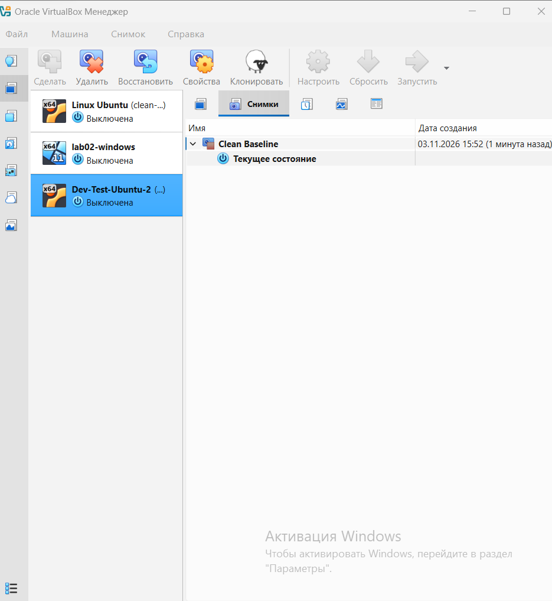

# Building a developer test machine: Ubuntu and Windows 11 in VirtualBox

> **DRAFT.** Replace every `[TODO: …]` and every **[SCREENSHOT]** line with your own real value or image, then delete this note. Walk through the finished document on a clean machine before submitting.

**Who this is for:** someone who has never used a virtual machine. Every step says what to click and why.
**Time:** about [TODO: your measured time, mostly waiting for installers].
**You need:** the computer that will run the machines, a Windows PC with 16 GB RAM and at least [TODO] GB free disk, and an internet connection.

**Words used in this guide**

- **Host** is the real computer. **Guest** is the virtual computer that runs inside it.
- **Snapshot** is a saved copy of a guest at one moment. You can go back to it later, and that is how "try things without breaking anything" works.
- **NAT Network** is a private virtual network that joins our guests to each other and lets them out to the internet, but hides them from the office network.

---

## Phase 0: Prepare the host

### Step 1. Download three files

- VirtualBox, from virtualbox.org.
- Ubuntu Desktop 26.04.1 LTS, the `.iso` file, from ubuntu.com.
- Windows 11 Enterprise Evaluation, the `.iso` file, from the Microsoft Evaluation Center.

An `.iso` is an installation disc stored as one file. The guests install from it the way a PC installs from a DVD.

> Check: three files in your Downloads folder. [TODO: sizes]

### Step 2. Install VirtualBox

Run the installer and accept the defaults. Do not install the "Extension Pack": this build does not need it, and it has a separate licence.

### Step 3. Create the shared network

Open VirtualBox, then **File → Tools → Network Manager → NAT Networks → Create**. [TODO: match these menu names to your VirtualBox version]

- Name: `NatNetwork`
- IPv4 prefix: `10.0.2.0/24`
- Tick **Enable DHCP**.

Why: both guests have to be on the same network to see each other. Without this step the **Name** list in Steps 8 and 13 is empty. Plain "NAT" is not enough, because it puts each guest on its own private network and they cannot reach each other.

**[SCREENSHOT: Network Manager showing NatNetwork with DHCP enabled]**

> Check: `NatNetwork` appears in the list.

---

## Phase 1: The Ubuntu guest

### Step 4. Create the virtual machine

Click **New** and expand each section of the wizard in turn.

- **Name:** `dev-test-ubuntu`
- **ISO Image:** the Ubuntu file from Step 1.
- **Type / Version:** Linux / Ubuntu (64-bit).
- Tick **Skip Unattended Installation**. Why: the automatic mode picks a username and password for you, and this guide needs you to see and choose them.
- **Hardware:** Memory `4096 MB`, CPUs `2`. Why: the host has 16 GB, and two guests at 4 GB leave 8 GB for the host. See README section 3.2.
- **Hard disk:** create a new disk, [TODO: 25 / 40] GB, type **VDI**, and leave **Pre-allocate Full Size** unticked. Why: the disk file then grows only as the guest writes data.

Click **Finish**.


[TODO: these two screenshots must show the VM they describe: name, size and settings the same as the text above.]

### Step 5. Attach it to the shared network

Select the VM, click **Settings → Network → Adapter 1**.

- **Attached to:** NAT Network
- **Name:** `NatNetwork`
- Leave everything else as it is (adapter type Intel PRO/1000 MT Desktop, promiscuous mode Deny).

Why: see Step 3.


### Step 6. Install Ubuntu

Start the VM and choose **Install Ubuntu**. [TODO: follow your installer screens and write what you actually chose: language, keyboard, installation type, username.] When it asks, choose to erase the disk. This is safe: it only erases the empty virtual disk, never the host. When the installer asks you to remove the installation medium, press **Enter**.

> Check: open a terminal and run `ip -4 addr`. You should see an address like `10.0.2.x`.


---

## Phase 2: The Windows 11 guest

### Step 7. Create the virtual machine

Click **New** again.

- **Name:** `dev-test-win11`
- **ISO Image:** the Windows file from Step 1.
- **Type / Version:** Microsoft Windows / Windows 11 (64-bit).
- Tick **Skip Unattended Installation**.
- **Hardware:** Memory `4096 MB`, CPUs `2`. Why: this is the Windows 11 minimum.
- **Hard disk:** `64 GB`, type **VDI**, **Pre-allocate Full Size** unticked. Why: 64 GB is Microsoft's minimum storage for Windows 11.

Click **Finish**. After this point you change settings through **Settings**, not through the wizard.

**[SCREENSHOT: Windows VM wizard with name, OS and hardware visible]**

### Step 8. Switch on what Windows 11 insists on

Select the VM and click **Settings → System → Motherboard**.

- Tick **Enable EFI**. If the box is already ticked and greyed out, leave it.
- Set **TPM** to `v2.0`.

Why: Windows 11 refuses to install on an old-style BIOS or without a TPM 2.0 chip. The installer stops with "This PC can't run Windows 11" before it reaches the disk. A virtual machine has neither unless you switch them on here.

[TODO: state whether you also ticked **Enable Secure Boot**. If the installation worked without it, say so; if you needed it, add the step.]

**[SCREENSHOT: Motherboard tab with EFI and TPM v2.0]**

> Check: in **System → Motherboard**, EFI is ticked and TPM says v2.0.

### Step 9. Attach it to the shared network

Same as Step 5: **Settings → Network → Adapter 1 → Attached to: NAT Network → Name: `NatNetwork`**.

**[SCREENSHOT: Windows VM network adapter]**

### Step 10. Optional display settings

[TODO: keep this step only if you can say what each setting fixed. In your first draft you set Video Memory to 128 MB, Graphics Controller to VBoxSVGA and 3D Acceleration on. If you cannot name a problem each one solved, delete this step and the matching line in README 3.3: the defaults are fine, and every extra setting is another thing the reader can get wrong.]

### Step 11. Install Windows

1. Start the VM. When you see "Press any key to boot from CD or DVD…", press a key immediately, or the VM will not start the installer.
2. Choose language, time and keyboard, then **Next → Install now**.
3. If asked for a product key, choose **I don't have a product key**. Choose the Enterprise Evaluation edition if offered.
4. Accept the licence terms.
5. Choose **Custom: Install Windows only (advanced)**.
6. Select the one 64 GB unallocated drive and click **Next**. Do not create partitions yourself; Windows creates the ones it needs.
7. Wait. The VM restarts by itself.

### Step 12. Create a local account

On the sign-in screen, [TODO: write exactly which option your screen offered, for example "Domain join instead" on Enterprise, and which edition you installed]. Choose a username and password and write them down.

If your screen insists on a Microsoft account and internet: press **Shift + F10**, type `oobe\bypassnro`, press **Enter**, let it restart, then choose **I don't have internet**. [TODO: this trick depends on the Windows build and Microsoft has been removing it; keep it only if you used it, and say so.]

> Check: you are on the Windows desktop.

### Step 13. Install Guest Additions

In the VM window menu: **Devices → Insert Guest Additions CD image…**. Open File Explorer, open the CD drive, run `VBoxWindowsAdditions.exe`, accept the defaults, and restart.

Why: this adds the drivers that let the screen resize with the window and the clipboard work between host and guest.

> Check: open PowerShell and run `ipconfig`. You should see an address like `10.0.2.x`.

---

## Phase 3: Check that it all works

### Step 14. Both guests reach the internet

On Ubuntu, in a terminal:

```
ping -c 4 8.8.8.8
ping -c 4 google.com
```

On Windows, in PowerShell:

```
ping 8.8.8.8
ping google.com
```

Why two: the first proves the guest can leave the network. The second proves names are being looked up. If the first works and the second does not, the problem is name lookup, not the network.

> Check: 0% loss on all four.

[TODO: save this output from both guests into evidence/05-ping-between-guests.txt]

### Step 15. The two guests see each other

Find the address of each guest (`ip -4 addr` on Ubuntu, `ipconfig` on Windows), then ping the other one: `ping -c 4 <Windows address>` on Ubuntu and `ping <Ubuntu address>` on Windows.

By default Windows Firewall blocks incoming ping. If the ping from Ubuntu to Windows times out while the ping from Windows to Ubuntu works, open PowerShell **as Administrator** and run:

```
New-NetFirewallRule -DisplayName "Allow ICMPv4-In" -Protocol ICMPv4 -IcmpType 8 -Direction Inbound -Action Allow
```

[TODO: say whether you needed this. If you did, this is your "what went wrong" for README 3.5.]

> Check: 0% loss in both directions. `evidence/05-ping-between-guests.txt`

---

## Phase 4: Your safety net

### Step 16. Take a snapshot of each guest

Shut the guest down. Select it in VirtualBox, open the **Snapshots** tab, click **Take** and name it `clean-install`.

Why: a snapshot of a clean system is the answer to "so he can try things without breaking anything". Take it right after the first clean install and updates, before the developer starts working.



[TODO: your current tree has three snapshots: `clean setup`, `Снимок 1` and `clean-install`. State which one is the clean baseline and why, and delete or rename the rest so a reader is not left guessing.]

### Step 17. Go back to the clean state

Select the guest, open **Snapshots**, right-click `clean-install`, choose **Restore**. Everything done after the snapshot is lost. That is the point.

---

## When something goes wrong

| What you see | Likely cause | Fix |
| :-- | :-- | :-- |
| Windows setup says "This PC can't run Windows 11" | EFI or TPM not switched on | Step 8 |
| `NatNetwork` is not in the **Name** list | The network was never created | Step 3 |
| Guest has no address, or the address is `169.254.x.x` | DHCP is off on `NatNetwork` | Step 3: tick **Enable DHCP** |
| Both guests show `10.0.2.15` and cannot see each other | Adapter is on plain NAT | Steps 5 and 9: choose **NAT Network** |
| Ubuntu cannot ping Windows, but Windows can ping Ubuntu | Windows Firewall blocks incoming ping | Step 15 |
| Windows install does not start | You missed the "Press any key" prompt | Restart the VM and press a key at once |
| Windows stops working after about 90 days | The evaluation licence has expired | Rebuild from a snapshot or buy a licence |
