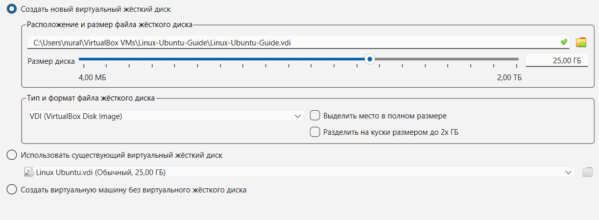
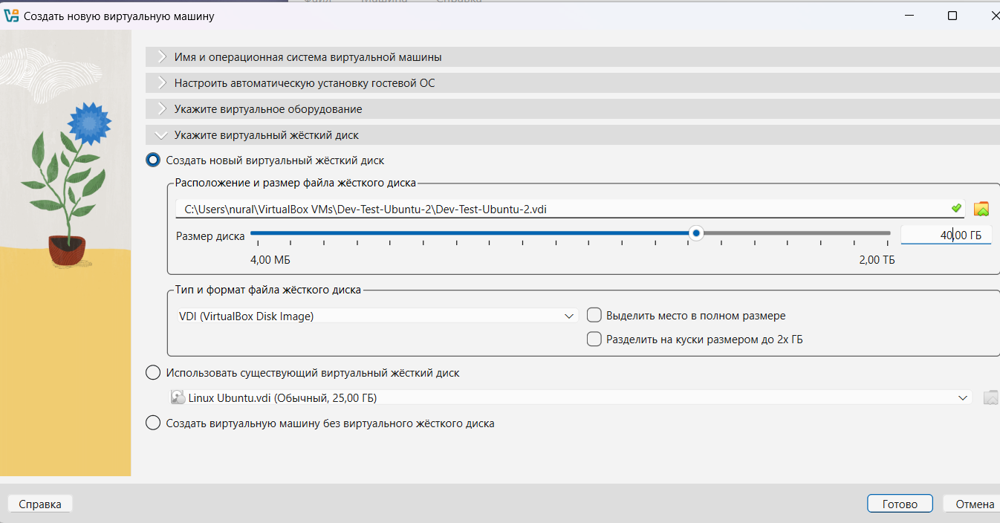
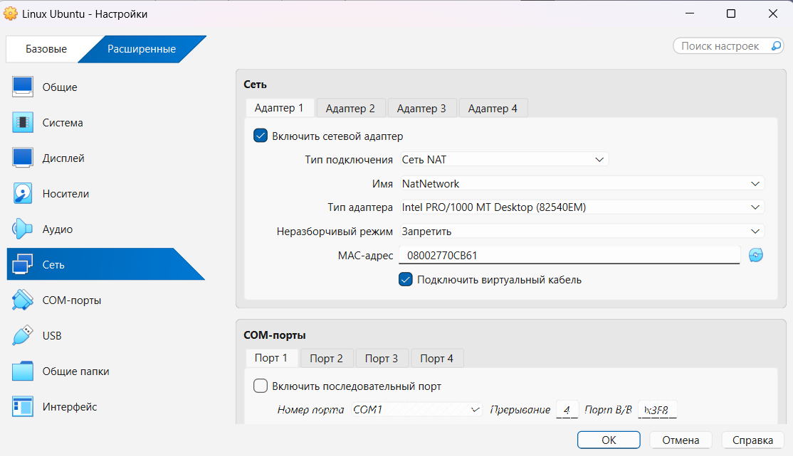

# Standard Operating Procedure: Multi-OS Test Environment Deployment

## Overview
This runbook enables non-technical staff to provision an isolated testing environment consisting of an **Ubuntu 26.04 LTS** virtual machine and a **Windows 11 Evaluation** virtual machine running on Oracle VM VirtualBox, connected via a shared virtual network with instant snapshot rollback capabilities.

---

## Prerequisites
* Oracle VM VirtualBox 7.x installed on the host system.
* Ubuntu 26.04.1 LTS ISO image downloaded.
* Windows 11 Enterprise / Evaluation ISO image downloaded.
* Minimum Host Resources: 16 GB RAM, 4 available physical CPU cores, and 120 GB free disk space.

---

## Phase 1: Create Shared Virtual Network (NatNetwork)
*Why this is required: Plain NAT isolates each virtual machine behind separate gateways, preventing them from communicating. NAT Network creates a shared virtual switch with outbound internet connectivity.*

1. Launch Oracle VM VirtualBox.
2. In the top menu, navigate to **File** -> **Tools** -> **Network Manager** (or press `Ctrl + H`).
3. Select the **NAT Networks** tab and click **Create** (plus icon).
4. Verify the newly created network:
   * **Name:** `NatNetwork`
   * **IPv4 Prefix:** `10.0.2.0/24`
   * **Enable DHCP:** Checked (enabled)
5. Click **Apply** and close the Network Manager.

---

## Phase 2: Provision Ubuntu 26.04 LTS Virtual Machine

### Step 1: Base Machine & Wizard Setup
1. Click **New** (blue badge icon) on the main toolbar.
2. Specify parameters:
   * **Name:** `Ubuntu-Test-Guest`
   * **Type:** `Linux`
   * **Version:** `Ubuntu (64-bit)`
   * **ISO Image:** Select your downloaded Ubuntu ISO.
   * Check **Skip Unattended Installation** to manually control disk layout and system packages.
3. Click **Next**.
4. Configure hardware resources:
   * **Base Memory (RAM):** `4096 MB` (4 GB)
   * **Processors:** `2 CPUs`
   * Check **Enable EFI** (optional for Linux, recommended for modern baselines).
5. Click **Next**.



### Step 2: Virtual Hard Disk Setup
1. Select **Create a Virtual Hard Disk Now**.
2. Set disk size to **40.00 GB**.
3. Choose **VDI (VirtualBox Disk Image)** format.
4. Ensure **Pre-allocate Full Size** is unchecked (Dynamically Allocated), saving physical SSD capacity.
5. Click **Finish**.



### Step 3: Network Interface Assignment
1. Select `Ubuntu-Test-Guest` and click **Settings** (`Ctrl + S`).
2. Go to **Network** -> **Adapter 1**.
3. Change **Attached to** from `NAT` to **NAT Network**.
4. Under **Name**, select `NatNetwork`.
5. Under **Advanced**, ensure **Cable Connected** is checked.
6. Click **OK**.



### Step 4: OS Installation & Identity Verification
1. Start the VM and proceed with standard minimal installation.
2. Create user account (`nuraly`).
3. After first boot into desktop/terminal, verify system identity:
   ```bash
   uname -a
   lsb_release -a